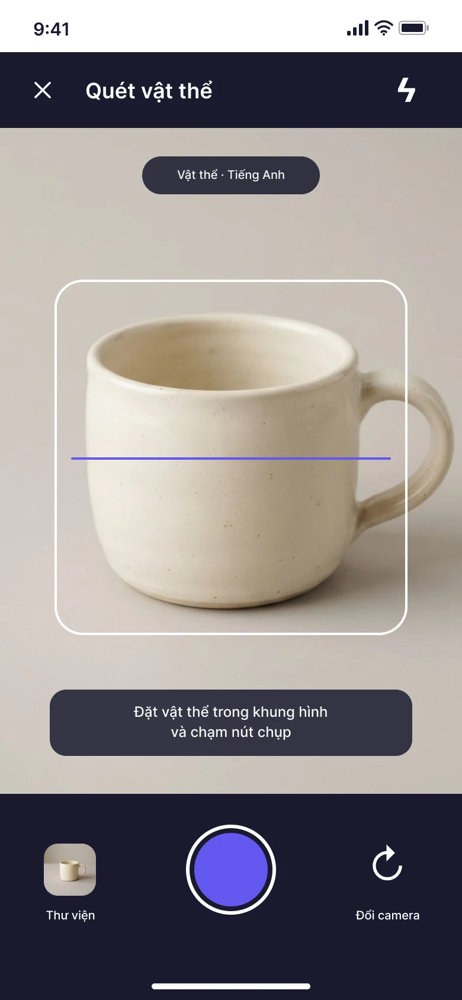
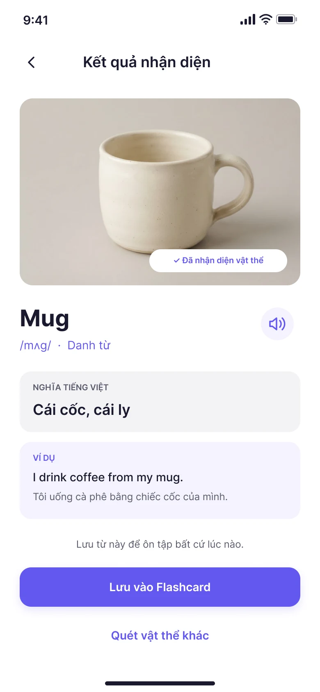
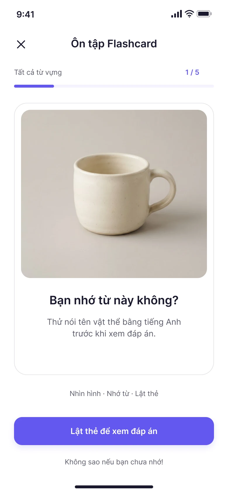

# Scanlinguo — Một từ mới, một bước tiến.

Chiếc cốc trên bàn tiếng Anh gọi là gì? Scanlinguo giúp người học tìm từ *mug*, nghe cách đọc và lưu ảnh chiếc cốc vào flashcard. Lần ôn sau, chính bức ảnh ấy là gợi ý để nhớ lại từ.

Ứng dụng hướng đến học sinh, sinh viên và người tự học muốn mở rộng vốn từ qua đồ vật thường gặp. Trên landing page, bạn có thể thử quét ảnh một chiếc cốc, một chậu cây hoặc một chiếc máy tính xách tay. Cả ba đều là ảnh mẫu có sẵn.

## Thử học từ *mug*

1. Trên landing page, chọn **Quét thử ngay → Cái cốc → Quét vật mẫu**.
2. Xem nghĩa *cái cốc, cái ly*, nhấn biểu tượng loa để nghe phát âm và đọc câu ví dụ *I drink coffee from my mug.*
3. Chọn **Lưu vào flashcard → Ôn tập ngay**. Nhìn ảnh và thử nói tên đồ vật trước khi chọn **Lật thẻ xem đáp án**.
4. Chọn **Đã nhớ** hoặc **Chưa nhớ**. Cuối lượt ôn, bạn có thể luyện lại riêng những từ vừa đánh dấu **Chưa nhớ**.

Bộ thẻ và các từ cần ôn lại được lưu bằng `localStorage` của trình duyệt trên thiết bị đang dùng.

## Giao diện ứng dụng

| Quét vật thể | Kết quả nhận diện | Mặt trước flashcard |
| :---: | :---: | :---: |
|  |  |  |

Thư viện trên landing page có đủ 10 màn hình, từ lúc làm quen đến khi xem tiến độ học tập. Chọn một ảnh để phóng to và đọc mô tả. 
